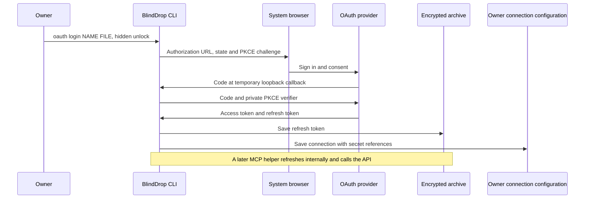

# Owner OAuth setup

BlindDrop can obtain a refresh grant through ordinary browser consent, either
from the app's connection sheet ([Sign in from the app](#sign-in-from-the-app))
or with the CLI `oauth login` command shown in the diagram below.
The owner runs this once; agents subsequently use the connection through the
existing MCP helper.
Controlled receiver proof and live provider proof are separate layers;
[CHANGELOG.md](CHANGELOG.md) states which providers have been exercised live.



## What the provider must already offer

An OAuth client registration permitting authorization code with S256 PKCE,
an HTTP loopback redirect, and a refresh token. Use the provider's normal
registration and consent controls; it needs no BlindDrop-specific integration.
The callback is `http://127.0.0.1:PORT/oauth/callback`. Omit `redirectPort` for
a free port; set it when the registration requires one specific port. Register
the exact callback required by that provider. The browser runs on the same
machine as the app or CLI. This is not the device-code flow or an OpenID
identity login. [Provider notes](#provider-notes) cover the templates' providers.

## Sign in from the app

In the connection sheet, choose an OAuth template — Google APIs, GitHub (OAuth
app) or Dropbox — or Custom with an OAuth refresh grant. Enter or select the
client bundle (the client ID, plus the client secret when your client type
requires one), the API origin and scopes, and the vault field that will hold
the refresh grant. That field can be in any unlocked vault. When you pick a
client bundle whose refresh field another connection already uses, the sheet
gives this connection its own refresh-grant secret instead. A grant you share
on purpose, through **Duplicate** or by choosing a field another connection
already uses for its grant, is replaced for all of those connections when any
of them signs in, with that connection's scopes; keep their scopes compatible,
or give one connection its own refresh-grant secret. Signing in never writes into a field another connection uses
as a different credential; the sheet names that connection. The sheet shows the callback to register with
the provider before you sign in.

Choose **Save and connect**:

1. The whole form is checked. A newly entered client bundle is saved first,
   and the sheet says **Client saved; waiting for authorization. The
   connection will be added after sign-in.**
2. Your system browser opens the provider's consent page. Sign in and approve.
3. When the provider returns a refresh token, the app saves it into the field
   you selected and then adds the connection. Until then the connection does
   not exist.

The app runs one sign-in at a time. **Cancel**, provider denial, the
five-minute timeout, starting another sign-in, locking a vault the connection
needs, Lock All and Quit end the attempt, and a late callback is rejected.
During **Sign in again…**, editing, turning off or removing that connection
also ends the attempt. The
saved client bundle stays; no refresh grant or connection is written. After a
denial or timeout the sheet stays open so you can try again with the saved
client; Cancel closes it and discards unsaved entries. Closing the window does
not cancel a sign-in, and reopening it shows whether the sign-in is pending,
finished or failed. Quitting or relaunching leaves no pending sign-in. Waiting
for the browser never delays locking. If the fixed callback port you set is
already in use, sign-in fails with `PORT_UNAVAILABLE`; choose another port that
matches the provider registration.

If the refresh grant was saved but the connection could not be, the sheet
says **Authorization saved; connection not added**, or **Authorization saved;
connection changes not saved** for an existing connection, adding that the
existing connection remains and the new authorization is kept. Save again to
finish without signing in again. Nothing is rolled back.

**Sign in again…** repeats consent for an existing connection, for example
after the provider revokes its grant; the agent then receives an error until
you do. The previous grant and connection stay in place until the new grant is
saved. A changed client bundle that you saved stays saved, including for other
connections that use it.

The app stores the issuer, authorization endpoint, fixed parameters and port
as the connection's `consent` settings
([configuration](CONFIGURATION.md#optional-connection-fields)). The agent
helper reads only the issuer, to check an ID token that a token refresh may
return; nothing else in them affects agent requests. Importing an existing refresh token in the connection
sheet, and the CLI flow below, remain available.

## Provider notes

These notes follow each provider's documentation; they are not live account
proof.

- **GitHub (OAuth app), GitHub.com.** Add the callback URL
  `http://127.0.0.1/oauth/callback` to the OAuth app, keeping any callback URL
  another application already uses. GitHub accepts a loopback callback on any
  port, so leave the port free. The client secret is required. Add the
  `offline_access` scope, or enable expiring user tokens for the app, so GitHub
  returns a refresh token; each refresh replaces it, and BlindDrop saves the
  replacement. GitHub Enterprise Server may not issue refresh tokens, and this
  template does not claim its refresh behavior.
- **Google APIs.** A Desktop client accepts the loopback callback on any port.
  Enter its client secret too: Google documents it as optional for Desktop
  clients, but its token endpoint is reported to reject a Desktop sign-in
  without it. A Web client needs its exact registered
  redirect, so register `http://127.0.0.1:PORT/oauth/callback` and set that
  fixed port. The template sends `access_type=offline` and `prompt=consent`,
  so a repeat sign-in or a Web client still receives a refresh token. Enter
  the API origin and scopes for the API you will call before **Save and
  connect**, which requires a scope; they are not derived from the client ID.
- **Dropbox.** Register the exact callback, including a fixed port, and set the
  same port. The authorization request needs `token_access_type=offline`. A
  PKCE public client (client authentication `none`) needs no app secret.

A token response without a refresh token fails with `UNSUPPORTED_RESPONSE`, and
no grant or connection is saved. The sheet says the provider returned no
refresh token: set the client up for offline access (for a GitHub OAuth app,
enable expiring user tokens) before signing in again.

## Example: Google Drive

This template follows Google's documented endpoints and desktop flow; a
live Google account has **not** been verified. Configure your own desktop
OAuth client and enable Drive for that project. Do not use `openid`, `email`
or `profile` identity scopes for this API-only flow. Google's client secret,
if required by your registration, is stored as a vault entry rather than in
the JSON definition. [Google desktop OAuth guidance](https://developers.google.com/identity/protocols/oauth2/native-app).

For a client using body authentication, first run:

```sh
blinddrop secret set google-client-secret
```

Enter the existing vault passphrase and client secret at the hidden prompts.
Do not initialize an existing vault again. Save this non-secret configuration
as `google-drive.json`, replacing the public client ID:

```json
{
  "issuer": "https://accounts.google.com",
  "authorizationEndpoint": "https://accounts.google.com/o/oauth2/v2/auth",
  "authorizationParameters": { "access_type": "offline", "prompt": "consent" },
  "connection": {
    "origin": "https://www.googleapis.com",
    "allowPrivate": false,
    "enabled": true,
    "auth": {
      "type": "oauth2",
      "tokenEndpoint": "https://oauth2.googleapis.com/token",
      "grant": "refresh_token",
      "clientId": "YOUR_CLIENT_ID.apps.googleusercontent.com",
      "clientAuth": "body",
      "clientSecret": "google-client-secret",
      "refreshSecret": "google-drive-refresh",
      "scope": "https://www.googleapis.com/auth/drive.readonly"
    }
  }
}
```

For a registered public client that does not require a client secret, use
`"clientAuth": "none"` and omit `clientSecret`. Basic authentication is also
available when the provider requires it. Preserve the provider's exact issuer
identifier, including whether it ends with `/`.

```sh
blinddrop oauth login google-drive ./google-drive.json
blinddrop list
```

Unlock once, complete the provider's normal browser flow, then wait for the
CLI's `OAuth grant and connection saved for the next session.` message.
The callback page only confirms receipt; the CLI confirms successful storage.
The refresh grant persists in the archive until replaced/removed; the provider
can independently expire or revoke it. “Next session” means existing helpers
keep their old snapshot, not that the saved secret expires when BlindDrop exits.

Stop an existing helper before replacing its credentials. Start a new helper
with `serve --allow google-drive --ttl 3600` through the normal MCP host setup.
The agent can then call `execute_http` with:

```json
{
  "connection": "google-drive",
  "path": "/drive/v3/files",
  "query": { "pageSize": "10", "fields": "files(id,name)" }
}
```

OAuth consent may require provider-specific offline-access parameters or
renewed consent before a refresh token is returned. An access-token-only
response fails without changing the vault. Google's offline-access guidance
explains its refresh-token issuance rules. [Google offline access](https://developers.google.com/identity/protocols/oauth2/web-server#offline).

## Other providers and fixed token targets

Use the provider's documented issuer, authorization endpoint, token endpoint,
resource origin, scopes and client authentication. `authorizationParameters`
is a bounded map for fixed extras such as `prompt` or `access_type`, never
credential values. Protocol fields, request objects, response mode, state,
PKCE, redirect, scope and targets cannot be overridden there.

OAuth `auth` accepts optional `audience` and `resource`, each a single owner-fixed
string of at most 2048 UTF-8 bytes. `resource` must be an absolute URI without
a fragment. Supply them only when the provider expects them. They are sent
with authorization/code exchange and with the configured client-credentials
or refresh grant. An agent's API query cannot change token targets. These
fields do not change or authorize network destinations.

## Lifetime, errors and proof limits

The command waits up to five minutes, then closes its loopback listener. Ctrl-C
or SIGTERM cancels it. Exchanges have the existing 30-second HTTPS bound.
There is no background login process after completion. Failed consent, state,
issuer, code verification, exchange or persistence returns a static error;
the command does not print the code, verifier or tokens. The access token from
onboarding is discarded; a future helper acquires its own through refresh.

`--no-browser` prints the authorization URL in the owner terminal for manual
opening and otherwise follows the same flow. The default launcher uses the established cross-platform `open` package. Desktop browser launch has not been tested end to end. Custom URI schemes, discovery, device flow, OpenID login and DPoP-bound grants are not implemented. Resource requests are never automatically replayed after an ambiguous failure
or a 401.
